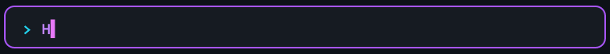
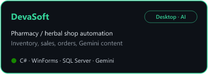
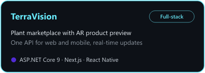
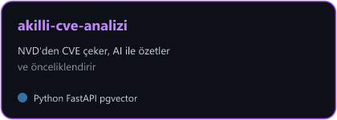
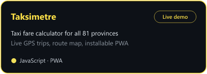

[Portfolio](https://kubradmrgc.github.io/portfolio/) · [LinkedIn](https://www.linkedin.com/in/k%C3%BCbra-demirg%C3%BC%C3%A7-8a058728b) · [Email](mailto:kubradmrgc965@gmail.com)

## About

I'm a final-year Software Engineering student at Fırat University. I build backend APIs, full-stack products and Windows desktop systems, mostly with C#/.NET, Python and TypeScript.

Open to **internships and junior backend / full-stack roles**.

- **Now shipping:** [DevaSoft](https://github.com/kubradmrgc/AktarOtomasyonu-DevaSoft) — pharmacy automation with inventory, sales and Gemini-assisted product content
- **Also active:** [TerraVision](https://github.com/kubradmrgc/TerraVision) — plant marketplace (web + mobile) on one ASP.NET Core API
- **Focus:** clean layered architecture, SQL-backed systems, REST APIs and applied LLMs

## Featured Projects

### [DevaSoft](https://github.com/kubradmrgc/AktarOtomasyonu-DevaSoft)

Windows desktop automation for herbal / pharmacy shops: products, stock, sales, purchase orders, role-based access and audit logs. Gemini generates product descriptions and usage notes. Layered C# services on SQL Server with DevExpress WinForms UI.

### [TerraVision](https://github.com/kubradmrgc/TerraVision)

Plant e-commerce with AR product preview, garden care planning, consultant chat and peer-to-peer swaps. One ASP.NET Core 9 API serves Next.js web and React Native mobile, with SignalR for live cart, orders and chat, plus CI for all three.

### [CVE Analysis Assistant](https://github.com/kubradmrgc/akilli-cve-analizi)

Ingests NVD vulnerabilities, summarizes and risk-scores them with an LLM, finds related CVEs via vector search and alerts on critical findings through Telegram. FastAPI, PostgreSQL with pgvector and a React dashboard.

### [Taksimetre](https://github.com/kubradmrgc/taksimetre) · [live demo](https://kubradmrgc.github.io/taksimetre/)

Taxi fare calculator for all 81 provinces in Turkey, with live GPS trip tracking, route mapping and a taxi stand directory. Installable PWA.

## Other Work

| Project | Description |
|---------|-------------|
| [portfolio](https://kubradmrgc.github.io/portfolio/) | Personal site with case studies and contact — React, TypeScript, Vite, Tailwind |
| **QubIT** *(private)* | IT quiz platform: Go services, React Native, adaptive difficulty, real-time leaderboard |
| **akredid** *(private)* | Academic credential verification with W3C DIDs / Verifiable Credentials; two-person Scrum team |
| [sigorta-dwh-pipeline](https://github.com/kubradmrgc/sigorta-dwh-pipeline) | Insurance DWH: OLTP → staging → warehouse → data marts (Informatica CDI + MySQL) |

## Tech Stack

| Area | Tools |
|------|-------|
| Languages | C#, TypeScript, Python, JavaScript, Go |
| Backend & desktop | ASP.NET Core, WinForms, FastAPI, SignalR, JWT |
| Frontend & mobile | Next.js, React, React Native |
| Data | SQL Server, PostgreSQL, pgvector, EF Core, MySQL, T-SQL |
| AI & tooling | Gemini, Docker, Git, GitHub Actions |

## Contact

Reach out for internships, junior roles or any project above.

[Portfolio](https://kubradmrgc.github.io/portfolio/) · [LinkedIn](https://www.linkedin.com/in/k%C3%BCbra-demirg%C3%BC%C3%A7-8a058728b) · [kubradmrgc965@gmail.com](mailto:kubradmrgc965@gmail.com)

