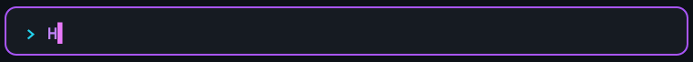
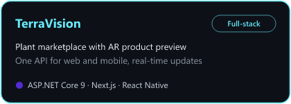
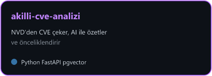
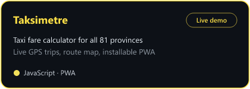
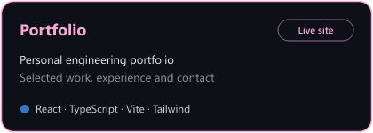

[Portfolio](https://kubradmrgc.github.io/portfolio/) · [LinkedIn](https://www.linkedin.com/in/k%C3%BCbra-demirg%C3%BC%C3%A7-8a058728b) · [Email](mailto:kubradmrgc965@gmail.com)

## About

I'm a final-year Software Engineering student at Fırat University, focused on backend and full-stack development. I design REST APIs and build the web and mobile clients that use them, mostly with .NET, Python and TypeScript.

I'm looking for **software engineering internships and junior backend or full-stack roles**.

- **Currently building:** [TerraVision](https://github.com/kubradmrgc/TerraVision), a plant marketplace with AR preview and real-time updates across web and mobile
- **Interested in:** API design, clean architecture, data pipelines and applied LLMs

## Featured Projects

### [TerraVision](https://github.com/kubradmrgc/TerraVision)

A plant e-commerce platform with AR product preview, a garden care planner, consultant chat and peer-to-peer item swaps. A single ASP.NET Core 9 API serves both a Next.js web app and a React Native mobile app, with real-time cart, order and chat updates over SignalR and a CI pipeline for all three.

### [CVE Analysis Assistant](https://github.com/kubradmrgc/akilli-cve-analizi)

Pulls vulnerabilities from the NVD, summarizes and risk-scores them with an LLM, finds related CVEs through vector search and sends critical alerts to Telegram. Built with FastAPI, PostgreSQL with pgvector, and a React dashboard.

### [Taksimetre](https://github.com/kubradmrgc/taksimetre) · [live demo](https://kubradmrgc.github.io/taksimetre/)

A taxi fare calculator covering all 81 provinces in Turkey, with live GPS trip tracking, route mapping and a taxi stand directory. Ships as an installable PWA.

### [Portfolio](https://github.com/kubradmrgc/portfolio) · [live site](https://kubradmrgc.github.io/portfolio/)

My personal site with project case studies, experience and contact details. Built with React, TypeScript, Vite and Tailwind CSS.

## Other Work

| Project | Description |
|---------|-------------|
| **QubIT** *(private)* | IT quiz platform with Go microservices, a React Native app, adaptive difficulty and a real-time leaderboard |
| **akredid** *(private)* | Academic credential verification built on W3C DIDs and Verifiable Credentials; two-person team working in Scrum with ADRs |
| [sigorta-dwh-pipeline](https://github.com/kubradmrgc/sigorta-dwh-pipeline) | Insurance data warehouse from OLTP to staging, DWH and data marts, built with Informatica CDI and MySQL |

## Tech Stack

| Area | Tools |
|------|-------|
| Languages | C#, TypeScript, Python, JavaScript, Go |
| Backend | ASP.NET Core, FastAPI, SignalR, JWT |
| Frontend & mobile | Next.js, React, React Native |
| Data | PostgreSQL, pgvector, SQL Server, EF Core, MySQL |
| Tooling | Docker, Git, GitHub Actions |

## Contact

Happy to talk about internships, junior roles or any of the projects above.

[Portfolio](https://kubradmrgc.github.io/portfolio/) · [LinkedIn](https://www.linkedin.com/in/k%C3%BCbra-demirg%C3%BC%C3%A7-8a058728b) · [kubradmrgc965@gmail.com](mailto:kubradmrgc965@gmail.com)

