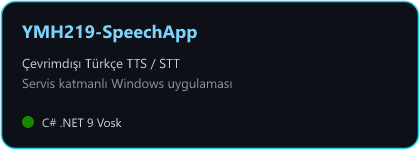
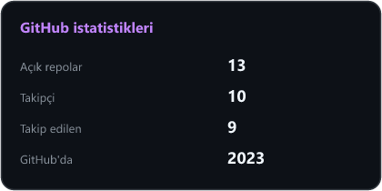
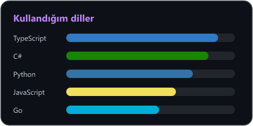

**[Canlı portfolyo](https://kubradmrgc.github.io/portfolio/)** · **[LinkedIn](https://www.linkedin.com/in/k%C3%BCbra-demirg%C3%BC%C3%A7-8a058728b)** · **[E-posta](mailto:kubradmrgc965@gmail.com)** · **[GitHub](https://github.com/kubradmrgc)**

---

### Kübra Demirgüç

Fırat Üniversitesi **Yazılım Mühendisliği** 4. sınıf öğrencisiyim. Backend API, full-stack web ve mobil ürünler geliştiriyorum. **Staj ve junior backend / full-stack** rollerine açığım.

İngilizce tarama için: *Software engineering student building APIs and full-stack products (.NET, Python, TypeScript). Open to internships.*

- **Canlı site:** [kubradmrgc.github.io/portfolio](https://kubradmrgc.github.io/portfolio/)
- **Şu an:** [TerraVision](https://github.com/kubradmrgc/TerraVision) (e-ticaret + AR + realtime) ve [SpeechApp](https://github.com/kubradmrgc/YMH219-SpeechApp) (çevrimdışı TTS/STT)
- **Odak:** REST API tasarımı, temiz katmanlı kod, uçtan uca çalışan sistemler
- **Aradığım:** ürün ekibinde staj / junior — backend ağırlıklı, full-stack de olur

---

## Teknoloji

Diller ve araçlar, ödev sayısından değil **teslim ettiğim ürünlerden** geliyor.

| Katman | Kullandıklarım |
|--------|----------------|
| Dil | C#, TypeScript, Python, JavaScript, Go |
| Backend | ASP.NET Core 9, FastAPI, SignalR, JWT |
| İstemci | Next.js 15, React, React Native |
| Veri | PostgreSQL / pgvector, SQL Server, EF Core, MySQL |
| Çalıştırma | Docker, GitHub Actions CI |

---

## İnceleme için 4 proje

İşe alım taramasında zaman kısıtlı. Bu dörtlü, ne ürettiğimi en net gösterir. Hepsi **herkese açık**.

| Proje | Ne işe yarıyor | Neden bakın | Yığın |
|-------|----------------|-------------|-------|
| [TerraVision](https://github.com/kubradmrgc/TerraVision) | Bitki e-ticareti, AR önizleme, bahçe bakımı, danışmanlık sohbeti, TerraTakas | Tek API üzerinde web + mobil, SignalR realtime, CI | ASP.NET Core 9 · Next.js · React Native |
| [akilli-cve-analizi](https://github.com/kubradmrgc/akilli-cve-analizi) | NVD’den CVE çeker, AI ile özetler, risk skorlar, panele ve Telegram’a iletir | Backend + RAG + React panel, çalışan uçtan uca akış | FastAPI · PostgreSQL/pgvector · React |
| [taksimetre](https://github.com/kubradmrgc/taksimetre) | 81 il taksi ücreti, canlı GPS yolculuk, harita, durak ve şikayet hatları | [Canlı demo](https://kubradmrgc.github.io/taksimetre/) — tarayıcıda açılır | JavaScript · PWA |
| [YMH219-SpeechApp](https://github.com/kubradmrgc/YMH219-SpeechApp) | Türkçe metni seslendirir, mikrofon/WAV konuşmayı yazıya çevirir (internetsiz) | Servis katmanı, iptal/ilerleme, hata yönetimi | C# · .NET 9 · Vosk · NAudio |

**90 saniyelik tur:** canlı portfolyo → TerraVision README mimarisi → CVE panel akışı → taksimetre canlı site.

---

## Diğer seçili çalışmalar

| Çalışma | Not |
|---------|-----|
| [portfolio](https://github.com/kubradmrgc/portfolio) | Kişisel mühendis sitesi, vaka anlatımlı işler. React + TypeScript + Vite + Tailwind. |
| [QubIT](https://github.com/kubradmrgc/QubIT) | IT quiz platformu (Go servisler, React Native, Redis/Kafka iskeleti). Repo özel; mimari üzerine konuşabilirim. |
| [akredid](https://github.com/kubradmrgc/akredid) | Akademik belge doğrulama ağı (W3C DID / Verifiable Credential). İki kişilik ekip, Scrum + ADR. Repo özel. |
| [sigorta-dwh-pipeline](https://github.com/kubradmrgc/sigorta-dwh-pipeline) | Sigorta OLTP → staging → DWH → datamart. Informatica CDI + MySQL, 26 mapping / 10 analitik sorgu. |
| [YMH219-ChatApp](https://github.com/kubradmrgc/YMH219-ChatApp) | C# TCP sohbet: sunucu + istemci, özel mesaj, LAN. |

---

## GitHub özeti

Dil çubukları GitHub’ın ödev ağırlıklı byte sayımı değil; **son dönemde ürün verdiğim diller**.

---

## İletişim

Staj / mülakat / proje konuşması için yazmanız yeterli.

**[Canlı portfolyo](https://kubradmrgc.github.io/portfolio/)** · **[LinkedIn](https://www.linkedin.com/in/k%C3%BCbra-demirg%C3%BC%C3%A7-8a058728b)** · **[kubradmrgc965@gmail.com](mailto:kubradmrgc965@gmail.com)**

